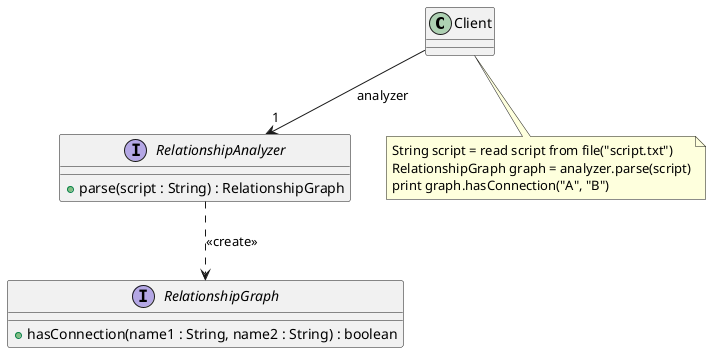

# 好友關係分析器（Relationship Analyzer）— 軟體需求規格書（SRS）

## 1. 簡介

### 1.1 目的

本系統提供一個簡易的好友關係分析器。使用者提供描述好友關係的文字腳本，系統解析腳本後，依據輸入的人名查詢：

1. 兩人之間的所有共同好友。
2. 兩人之間是否存在連結（進階需求）。

本文件整理系統應具備的功能與外部可觀察行為，不限定內部資料結構或演算法；課程指定的介面與整合限制另列於設計約束。

### 1.2 系統範圍

系統以純文字檔案作為好友關係腳本的輸入來源。Client 負責讀取檔案、呼叫分析器及呈現查詢結果。分析器負責解析腳本並提供好友關係查詢能力。

### 1.3 名詞定義

| 名詞 | 定義 |
|---|---|
| 人名（Name） | 用來識別社群成員的名稱。 |
| 好友關係（Friendship） | 兩個人之間的好友關係，為雙向關係。 |
| 好友清單 | 某人所有好友名稱的集合。 |
| 共同好友（Mutual Friend） | 同時是兩位指定對象好友的人。 |
| 連結（Connection） | 兩人之間存在一條由一個或多個好友關係連接而成的路徑。 |
| 關係腳本（Relationship Script） | 以指定文字格式描述多組好友關係的內容。 |
| Client | 使用分析器功能、讀取腳本並呈現查詢結果的呼叫端程式。 |

---

## 2. 整體描述

### 2.1 使用者與系統操作流程

基本功能的操作流程：

1. Client 從純文字檔案讀取完整的好友關係腳本。
2. Client 將腳本字串交給好友關係分析器解析。
3. 使用者／Client 提供兩個人名。
4. 分析器回傳兩人之間的所有共同好友。
5. Client 印出共同好友列表。

進階功能的操作流程：

1. Client 從純文字檔案讀取完整的好友關係腳本。
2. Client 將腳本字串交給好友關係分析器解析，取得好友關係圖。
3. Client 提供兩個人名。
4. 好友關係圖回傳兩人之間是否存在連結。
5. Client 印出查詢結果。

### 2.2 前提與依賴

- 輸入來源為純文字檔案。
- 腳本內容須符合所選版本規定的格式。
- 人名由腳本及查詢輸入提供。
- 進階功能可整合程式語言可用的第三方 Graph 套件，以支援 connectivity analysis。

---

## 3. 功能需求

### 3.1 好友關係腳本解析

**FR-001：讀取好友關係腳本**

系統應允許 Client 讀取純文字檔案，取得完整腳本字串。

**FR-002：解析好友關係腳本**

分析器應能解析符合指定格式的好友關係腳本，建立可供後續查詢的好友關係資訊。

**FR-003：好友關係為雙向**

若腳本描述 A 與 B 為好友，則查詢時應視為 A 是 B 的好友，且 B 也是 A 的好友。

### 3.2 共同好友查詢（基本需求）

**FR-004：查詢共同好友**

分析器應提供共同好友查詢能力。輸入兩個人名 `name1`、`name2`，系統應回傳兩人之間的所有共同好友。

**FR-005：共同好友判定**

對於任一人 C，當且僅當以下條件同時成立時，C 才是 A 與 B 的共同好友：

- A 與 C 為好友。
- C 與 B 為好友。

**FR-006：共同好友結果順序**

共同好友的回傳順序不具要求；只要結果包含所有且僅包含符合條件的人名即可。

### 3.3 連結查詢（進階需求）

**FR-007：查詢兩人是否存在連結**

系統應提供連結查詢能力。輸入兩個人名 `name1`、`name2`，系統應回傳兩人之間是否存在連結（布林值）。

**FR-008：連結判定與範例**

若存在一條由好友關係連接而成的路徑：

`A — x1 — x2 — ... — xn — B`

且路徑上每一對相鄰的人皆為好友，則 A 與 B 之間存在連結。路徑可以只有一段直接好友關係，也可以包含一個或多個中間人。

依據第 4.1 節或第 4.2 節的範例關係：

- **A 與 C 存在直接連結**：腳本中 A 與 C 為好友。
- **A 與 M 存在間接連結**：A 與 C 為好友，且 C 與 M 為好友，因此可透過 `A — C — M` 抵達 M。即使 A 與 M 並非直接好友，仍視為存在連結。
- **A 與 F 不存在連結**：A 所在的好友關係群組無法透過任何好友關係路徑抵達 F；F 與 Z 所屬於另一個獨立群組。

因此，「兩人之間是否存在連結」是判斷兩人是否位於同一個好友關係連通群組，而不只是判斷兩人是否直接互為好友。


**FR-009：連結具有雙向性**

若 A 與 B 之間存在連結，則 B 與 A 之間也存在連結。

**FR-010：間接連結**

連結不要求兩人直接互為好友；只要能透過一個或多個中間人沿好友關係抵達，即視為存在連結。

### 3.4 輸出與呈現

**FR-011：呈現共同好友**

Client 應印出共同好友查詢所得的列表。

**FR-012：呈現連結查詢結果**

Client 應印出兩人之間是否存在連結的查詢結果。

---

## 4. 外部介面與資料格式

### 4.1 基本需求腳本格式（格式一）

每一行描述一個人的好友清單：

```text
<name>:
```

冒號後方須有一個空白，接著列出零至多個好友名稱。好友名稱以空白分隔。

範例：

```text
A: B
B: A D E
C: A E G K M
D: A B K P
E: B C J K L
F: Z
```

說明：
- 每行開頭為人名，後接冒號。
- 冒號後有一個空白。
- 冒號後可列出 0 至多個好友名稱。
- 每行描述該人所擁有的好友清單。

### 4.2 整合實作所使用的腳本格式（格式二）

課程整合題提供的 `SuperRelationshipAnalyzer` 使用另一種腳本格式。每一行描述一組好友關係：

```text
<name1> -- <name2>
```

範例：

```text
A -- B
A -- C
A -- D
B -- D
B -- E
C -- E
C -- G
C -- K
C -- M
D -- K
D -- P
E -- J
E -- K
E -- L
F -- Z
```

說明：
- 每行包含兩個人名。
- 兩個人名以 ` -- ` 分隔。
- 每一行表示兩人互為好友。
- 此格式與第 4.1 節格式不同，不應視為同一種輸入格式。

### 4.3 查詢介面資料

| 查詢 | 輸入 | 輸出 |
|---|---|---|
| 共同好友查詢 | `name1`、`name2` | 共同好友名稱列表 |
| 連結查詢 | `name1`、`name2` | `true` 或 `false` |

---

## 5. 設計與整合約束

本節記錄課程題目明確指定的相容性限制。這些限制屬於設計／實作約束，不應與系統功能需求混為一談。

### 5.1 基本分析器介面

基本版本以 `RelationshipAnalyzer` 表達分析好友關係的意圖，需提供：

- `parse(script)`：接收第 4.1 節所述格式的腳本字串。
- `getMutualFriends(name1, name2)`：回傳兩人之間的所有共同好友。

Client 的既定使用流程為：讀取檔案、呼叫 `parse`、呼叫 `getMutualFriends`，並印出結果。

### 5.2 整合第三方分析器的限制

課程提供的 `SuperRelationshipAnalyzer`：

- 以 `init(script)` 接收第 4.2 節所述格式的腳本字串。
- 以 `isMutualFriend(targetName, name1, name2)` 判斷指定的 `targetName` 是否為 `name1` 與 `name2` 的共同好友。

整合時必須符合以下限制：

- 不得修改 `Client` 的任何程式碼。
- 不得修改 `RelationshipAnalyzer` 的任何程式碼。
- 不得修改 `SuperRelationshipAnalyzer` 的任何程式碼。
- 必須整合 `SuperRelationshipAnalyzer`，使既有 Client 仍能完成共同好友查詢意圖。

### 5.3 進階分析器介面

進階版本包含 `RelationshipAnalyzer` 與 `RelationshipGraph` 兩個介面：

- `RelationshipAnalyzer.parse(script : String) : RelationshipGraph`：接收第 4.1 節格式的腳本字串，解析後建立並回傳 `RelationshipGraph`。
- `RelationshipGraph.hasConnection(name1 : String, name2 : String) : boolean`：回傳兩人之間是否存在連結。

Client 與 `RelationshipAnalyzer` 具有單向關聯，角色名稱為 `analyzer`，多重度為 1。`RelationshipAnalyzer` 透過 `<<create>>` 建立 `RelationshipGraph`。

Client 的既定使用流程為：讀取檔案、呼叫 `parse` 取得 `RelationshipGraph`、呼叫 `hasConnection`，並印出結果。

進階需求類別圖的 PlantUML：



### 5.4 第三方 Graph 套件整合限制

進階題要求整合程式語言可用的第三方 Graph 套件，以支援 connectivity analysis，並符合以下限制：

- 不得修改 `Client` 的任何程式碼。
- 不得修改 `RelationshipAnalyzer` 的任何程式碼。
- 不得修改 `RelationshipGraph` 的任何程式碼。
- 整合後仍須滿足既有 Client 的連結查詢意圖。